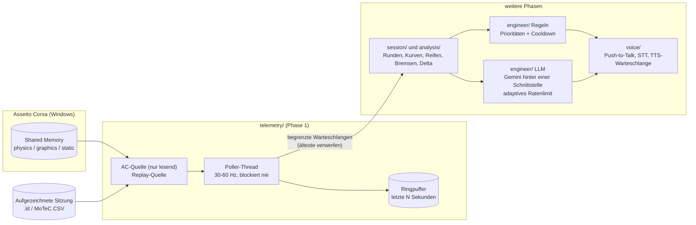

# pit-wall-ai

**Ein KI-Renningenieur in Echtzeit für Assetto Corsa.** Er läuft im Hintergrund, während du fährst, liest die
Live-Telemetrie des Spiels, warnt dich vor dem, was zählt (Reifen, Bremsen, Sprit, Pace, Bremspunkte) und
antwortet, wenn du mit ihm sprichst. Die regelbasierten Warnungen sind lokal und sofort; ein Sprachmodell
(die kostenlose API von Gemini, austauschbar) wird nur für die Unterhaltung benutzt.

*English: [README.md](README.md) · Español: [README.es.md](README.es.md)*

> **Stand: nutzbar für das originale Assetto Corsa; offen ist vor allem der Live-Test des Push-to-Talk mit
> Lenkrad.** Live-Telemetrie, Sitzungs- und Rundenverfolgung, Aufzeichnung und Wiedergabe, ein regelbasierter
> Ingenieur mit lokaler Windows-Stimme, Bremsanalyse pro Kurve gegen die eigene Bestzeit, Reifenverschleiß pro
> Kurve, ein Text- und Sprach-Chat (lokale Antworten zuerst, ein Cloud-Modell nur, wenn du es erlaubst), drei
> Sprachen (Spanisch, Englisch, Deutsch), gesprochene Glückwünsche zu Pole und Ergebnis und ein Gedächtnis
> dessen, was gesagt wurde. Siehe die [Roadmap](#roadmap).

<!-- DEMO: add a GIF or video here (terminal dashboard now, voice demo later) -->
<p align="center"><em>Platzhalter für die Demo: Hier kommt ein GIF des Dashboards hin.</em></p>

## Architektur



Die Telemetrie-Schleife liest nur eine Quelle und hängt an den Puffer an. Alles Langsame (Netzwerk, Audio,
Analyse) läuft in anderen Threads und bekommt die Samples über begrenzte Warteschlangen: Ein langsamer
Verbraucher verliert seine ältesten Samples, statt die Schleife zu bremsen.

## Was Phase 1 liefert

* **`telemetry/`**: typisierter, unveränderlicher `Snapshot`; `ACSharedMemorySource` (Windows, nur lesendes
  `OpenFileMappingW`, Wiederholung bei gerissenen Lesungen, Erkennung des Spielendes); `ReplaySource` für
  `.ld`- und MoTeC-CSV-Logs (Echtzeit-Takt, Geschwindigkeitsfaktor, Schleife, Startversatz); `RingBuffer`;
  `TelemetryPoller`.
* **Dashboard** im Terminal (`pit-wall run`) und **`pit-wall dump-shm`**, um jedes Feld zu prüfen und die
  Einheiten zu bestätigen.
* **Konfiguration** in YAML + `.env`, validiert (ein Tippfehler im YAML ist ein Fehler), und **strukturiertes
  Logging** (key=value oder JSON-Zeilen).
* **LLM-Grundlagen**: Provider-Schnittstelle mit Registry (ein Offline-`mock` ist enthalten), ein **adaptiver
  Rate-Limiter** (lernt aus HTTP 429 / `Retry-After`, optionales Tagesbudget), ein kurzer Cache und sanfte
  Degradation.

## Installation

Für das Live-Spiel wird Windows benötigt (der Replay läuft überall) sowie Python 3.11+.

```powershell
git clone https://github.com/ElSirGuti/pit-wall-ai.git
cd pit-wall-ai
python -m venv .venv
.venv\Scripts\activate
pip install -e ".[dev]"
copy .env.example .env     # nur für das Cloud-Modell (Gemini-Schlüssel) nötig
```

## Benutzung

```powershell
# Live, mit laufendem Assetto Corsa
pit-wall run

# Ohne Spiel: ein eigenes ACTI-Log mit 4-facher Geschwindigkeit ab Sekunde 100 abspielen
pit-wall run --source replay --file C:\path\to\session.ld --speed 4 --start 100

# Eine Statuszeile pro Sekunde (ohne Dashboard)
pit-wall run --plain

# Eine echte Sitzung aufzeichnen (die Felder des Spiels) und später abspielen
pit-wall record --out race.pwrec.gz
pit-wall run --file race.pwrec.gz --speed 4

# Phase 4: nummerierte Kurven einer Strecke aus der Ideallinie des Spiels, und jede Runde gegen die Bestzeit
pit-wall corners --file race.pwrec.gz
pit-wall corners --file race.pwrec.gz --laps
pit-wall corners --track spa --length 6947

# Jedes vom Spiel veröffentlichte Feld anzeigen (und mit --watch den Wertebereich jedes Feldes)
pit-wall dump-shm
pit-wall dump-shm --watch 60 --json report.json

# Der Ingenieur: die Warnungen sprechen (Windows-Stimme; pip install -e ".[voice]")
pit-wall run --voice                 # Spanisch, Sabina falls installiert
pit-wall run --voice --language de   # Deutsch (en für Englisch)
pit-wall run --mute                  # dieselben Regeln, gedruckt statt gesprochen
pit-wall tyre-corners race.pwrec.gz  # welche Kurven die Reifen am meisten belasten (Schätzung, validiert oder nicht)
pit-wall say "Box this lap"          # die Stimme testen und ihre Latenz sehen

# Mit dem Ingenieur sprechen (Push-to-Talk): siehe docs/VOICE.de.md
pit-wall devices                     # Mikrofone und Ausgänge
pit-wall voices --test               # jede installierte Stimme anhören
pit-wall voice                       # Live-Unterhaltung (Taste + Mikrofon)
pit-wall stt-test --device both      # Spracherkennung: Geschwindigkeit und Genauigkeit, CPU gegen GPU
pit-wall rules                       # aktive Regeln, Schwellen und Richtlinien pro Sitzung
```

In [docs/ENGINEER.de.md](docs/ENGINEER.de.md) steht, wie eine Meldung entschieden wird, welche Regeln es gibt und die
gemessene Latenz; [docs/TRACK_GEOMETRY.md](docs/TRACK_GEOMETRY.md) beschreibt die Kurvengeometrie, den
Bremsvergleich, den gesprochenen Hinweis und wie die Ausrichtung zur Rundenposition des Spiels verifiziert
wurde (Fehler unter 0,5 m in Magione, Imola, Spa).

```bash
# Der Text-Chat (lokale Antworten immer; das Cloud-Modell nur, wenn du es einschaltest, siehe docs/LLM.md)
pit-wall ask "how much fuel is left?" --file race.pwrec.gz
pit-wall chat                       # Live-Spiel; exit zum Beenden
pit-wall llm-check --allow-cloud    # das Cloud-Modell testen
```

Ein Chat, jeder Dienst: Der Plan für andere Anbieter und die endgültige `.exe` steht in
[docs/PROVIDERS_PLAN.md](docs/PROVIDERS_PLAN.md).

`pit-wall --help` listet alle Optionen auf. Die Prüfungen laufen mit `pytest` und `ruff check src tests`.

## Konfiguration

Die Standardwerte stehen in [`config/default.yaml`](config/default.yaml) (sie entsprechen den eingebauten).
Kopiere die Datei nach `config/local.yaml` (von git ignoriert) oder setze `PIT_WALL_CONFIG` auf eine Datei.
Geheimnisse gehören nie ins YAML: Lege `GEMINI_API_KEY` in `.env` ab, die vom ersten Commit an von git
ignoriert wird. Der LLM-Abschnitt wählt schon den Anbieter und sein adaptives Tempo (`rate_limit`): Die
Kontingente des kostenlosen Tarifs ändern sich mit der Zeit und werden nur pro Projekt in Google AI Studio
angezeigt, deshalb lernt der Limiter, statt einer festen Zahl zu vertrauen.

## Einheiten der Felder des Spiels

Das Spiel veröffentlicht seine Werte in eigenen Einheiten, und es gibt **keine offizielle Kunos-Referenz für
die Seiten des originalen Assetto Corsa** (das im Umlauf befindliche PDF gehört zu ACC, einem anderen Spiel).
Jede Einheit wird also gegen das Spiel selbst bestätigt. Details und das Verfahren:
[`docs/AC_SHARED_MEMORY.md`](docs/AC_SHARED_MEMORY.md).

Status: **verified** (verifiziert) = durch eine unabhängige Beziehung innerhalb einer echten Aufzeichnung
bestätigt (Wanduhr, Geschwindigkeit gegen Raddrehzahl und Reifenradius, Distanz gegen mittlere
Geschwindigkeit); **plausible** (plausibel) = der Bereich passt zur Einheit, aber nichts Unabhängiges hat es
geprüft (mit dem HUD vergleichen); **undetermined** (unbestimmt) = noch nicht verstanden; **unreliable**
(unzuverlässig) = das Spiel liefert für dieses Auto keinen brauchbaren Wert.

| Feld | Einheit | Status | Beleg |
|---|---|---|---|
| `speed_kmh` | km/h | verified | entspricht der Norm von `local_velocity` × 3,6 auf 7 Stellen |
| `velocity, local_velocity` | m/s; im Fahrzeugsystem z = vorwärts, x = seitlich, y = vertikal | verified | Norm × 3,6 = `speed_kmh`; z dominiert |
| `wheel_angular_speed` | rad/s | verified | ω × Reifenradius ≈ Geschwindigkeit (vorn −0,4 %…−1,9 %, angetriebene Hinterachse +4,7 % bei Wheelspin) |
| `static.tyre_radius` | Meter | verified | gleiche Prüfung (0,34 m vorn, 0,3525 m hinten) |
| `distance_traveled` | Meter | verified | 2256,9 m gegen mittlere Geschwindigkeit × 60 s = 2257,6 m |
| `current_time_ms, session_time_left` | Millisekunden | verified | Δ = 59 993 ms bei einer 60-s-Aufzeichnung (20 002 ms bei 20 s) |
| `gas, brake` | 0..1 | verified | beobachtet 0,0 … 1,0 (Bremse in der Box auf 1,0 gehalten) |
| `heading` | Radiant, −π..π | verified | beobachtet −3,134 … 3,135 über eine Runde |
| `normalized_pos` | 0..1 um die Runde | verified | 0,18 … 0,68, steigt mit `distance_traveled` |
| `acc_g` | g; x = seitlich, y = vertikal (ohne Schwerkraft), z = längs | plausible | Spitzen ±2 g; Bremsen (−1,9) stärker als Beschleunigen (+1,1) auf z; Vorzeichen am HUD noch zu prüfen |
| `wheel_load` | Newton | plausible | Summe in der Box 14,56 kN ≈ 1 484 kg·g für einen GT4 mit Sprit und Fahrer |
| `fuel` | Liter | plausible | 45,0 geladen, Tank 110,0; Verbrauch 0,73 L/km (3,3 L pro 4,5-km-Runde) |
| `tyre_pressure` | psi | plausible | 25,7 … 28,9 (ein Wert in bar läge bei ≈ 1,9) |
| `tyre_core_temp, tyre_temp_inner/middle/outer` | °C | plausible | 55 … 89 °C; 80 °C an der Box |
| `tyre_wear` | Prozent; 100 = neu | plausible | 100,0 bei neuen Reifen und ~1,7 Runden unverändert |
| `camber` | Radiant | plausible | −0,056 rad = −3,2° vorne links, rechts gespiegelt |
| `suspension_travel` | Meter | plausible | 0,011 … 0,080 |
| `brake_bias` | Anteil vorn | plausible | 0,74 konstant |
| `static.track_length_m` | Meter | plausible | 4537,19 für das verwendete Hockenheim-GP-Layout |
| `clutch` | sieht nach dem Einkuppeln aus (1,0 = eingekuppelt), nicht nach dem Pedal | undetermined | 0,0 im Leerlauf (Supra in der Box, Alfa 4C im Leerlauf) und 1,0 im Gang in jeder Aufzeichnung; die Bedienelemente des Fahrers haben die Pedalachse außerdem invertiert. Keine Regeln darauf bauen |
| `gear` | Rohindex = Gangnummer + 1: 1 = Leerlauf, 2…7 = 1. bis 6. (Rückwärtsgang vermutlich 0, nicht gesehen) | verified | HUD des Fahrers: roh 7 = 6. Gang, roh 1 = Leerlauf (auch bei 131 km/h mitten im Schalten gesehen) |
| `steer_angle` | Anteil des Lenkeinschlags, −1..1 (voller Einschlag = ±1,0; für Grad braucht man den Lenkradius des Autos) | verified | Anschlag-zu-Anschlag-Test: min −1,0000, max +1,0000 genau. Eine volle Umdrehung (360°) eines 900°-Lenkrads las −0,827 (×450° = 372°): linear zu ±450° des Lenkrads. Eine Haarnadelrunde erreicht ≈ 0,5. Linkslenken liest negativ (Fahrer lenkte links: −0,827), rechts positiv |
| `tc`, `abs` | `tc` sieht nach einem von der Einstellung abgeleiteten Wert aus, `abs` nach einer Konstante | undetermined | `tc` 1,0 in der Box und 0,065 … 1,0 in der ersten Aufzeichnung, konstant 0,082 in der zweiten mit TC auf 4/8 (Fahrer); `abs` konstant 0,12 |
| `wheel_slip` | Definition unbekannt | undetermined | 0 … 977,7 mit Ausreißern; kein begrenztes Verhältnis |
| `wind_speed` | Einheit unbekannt | undetermined | 2,0 konstant (m/s oder km/h) |
| `brake_temp` | prinzipiell °C | unreliable | 26 in der Box, 15,0 konstant auf der Strecke (= Lufttemperatur) beim Bremsen mit 244 km/h: für dieses Auto nicht simuliert; keine Bremsregeln darauf bauen |
| `static.max_power, max_torque` | — | unreliable | MX-5 Cup 108,7 kW / 187 N·m ist plausibel, Supra GT4 und Audi TCR nicht: es hängt vom Auto ab |

Verwendete Aufzeichnung: Assetto Corsa 1.16.4, Shared Memory 1.7, LFM-Trainingsserver, Toyota Supra GT4 in
Hockenheim (GP, kein DRS), 20 s in der Box + 60 s auf der Strecke (1 199 + 3 600 Samples). Die beiden Berichte
liegen in `tests/fixtures/`, und `tests/test_live_reports.py` prüft bei jedem Lauf jede Zeile *verified* neu.

## Roadmap

| Phase | Inhalt | Stand |
|---|---|---|
| 1 | Telemetrie-Leser, Mock/Replay, Konsolenansicht, LLM-Grundlagen | fertig |
| 2 | Sitzungserkennung (Training / Qualifying / Rennen), Runden- und Sektorverfolgung, `pit-wall record` | fertig, an einem echten Qualifying + Rennen geprüft ([Docs](docs/SESSION_AND_LAPS.md)) |
| 3 | Regelbasierte Warn-Engine mit lokalem TTS | fertig ([Docs](docs/ENGINEER.de.md)); Schwellen konservativ, noch zu kalibrieren |
| 4 | Bremsanalyse pro Kurve gegen die Bestzeit (lokal erzeugte Streckengeometrie) | fertig ([Docs](docs/TRACK_GEOMETRY.md)): Geometrie, Nummerierung, Vergleich pro Kurve und gesprochener Hinweis, an echten Strecken geprüft |
| 5 | Text-Chat mit dem Cloud-Modell (Gemini): kompakte Telemetrie-Zusammenfassung, lokale Antworten zuerst, Prüfung jeder Zahl ([Docs](docs/PHASE5_PLAN.md), [docs/LLM.md](docs/LLM.md)) | fertig: Evaluation 34/34, mehrere Schlüssel als Reserve |
| 6 | Sprache: Push-to-Talk auf jeder Taste jedes Geräts, Auswahl von Mikrofon und Stimme, lokale Spracherkennung (CPU oder GPU), gesprochene Antworten, Halbduplex-Funkregeln, „nicht stören“ ([Anleitung](docs/VOICE.de.md), [Plan](docs/PHASE6_PLAN.md)) | fertig und live mit Mikrofon, Lenkrad-Taste und GPU-Erkennung getestet (Erkennungsfehler werden laufend korrigiert); die 40 gesprochenen Sätze lassen sich mit `pit-wall phrases record` / `test` aufnehmen und messen |
| 6b | Der Ingenieur als Charakter: Persona und Namen, Gedächtnis der Unterhaltung pro Kurve, Sprachen es / en / de | teilweise fertig ([Docs](docs/ENGINEER_EXPERIENCE_PLAN.md)): Persona, Gedächtnis, Sprachen, Ruhemodus; Profile pro Simulator und Spritsparen pro Kurve offen |
| 6c | Der Ingenieur als MCP-Server, für Leute ohne API-Schlüssel ([Vorschlag](docs/MCP_PLAN.md)) | Vorschlag, zurückgestellt |
| 6d | Lokale neuronale Stimmen (Piper und Zero-Shot-Server mit eigenem Referenzaudio des Nutzers), Stimmprofile, Funkeffekt ([Plan](docs/VOICES_PLAN.md)) | Vorschlag |
| 7 | Nachbesprechung: schriftlicher Bericht und kurze gesprochene Zusammenfassung, mit Vergleich zum letzten Mal ([Plan](docs/PHASE7_PLAN.md)) | am 17.10.2026 freigegeben und gebaut: `pit-wall debrief DATEI` (Bericht, Zahlen, gesprochene Zusammenfassung mit geprüfter Formulierung des Modells oder Vorlage, `--save` für den Vergleich mit dem letzten Mal); live am Ende eines Rennens oder Qualifyings und auf Zuruf („dame el resumen de la sesión“) |
| 8 | Rennvorbereitung: Strategieplan mit editierbarer Trainings-Checkliste, Gegnerübersicht, Setup- und Fahrstil-Vorschläge, **Reifenverschleiß pro Kurve** | Reifenverschleiß pro Kurve ist fertig (eine Schätzung, pro Rad gegen die Reifen-App des Spiels validiert: `pit-wall tyre-corners`, und der Chat beantwortet es); 8a ist gebaut: der Spritplaner („wie viel Sprit für 10 Minuten“, „komme ich ins Ziel?“), der Stoppplan aus den Regeln, die du nennst, und die editierbare Trainings-Checkliste, die sich selbst abhakt (`pit-wall checklist` oder per Sprache); die Gegner kommen von der CSP-Brücke; Setup- und Fahrstil-Vorschläge sind weiter geplant, siehe [docs/PHASE8_PLAN.md](docs/PHASE8_PLAN.md) |
| 9 | Weitere Simulatoren (ACC, iRacing, rFactor 2 / Le Mans Ultimate, Automobilista 2, RaceRoom, AC Evo) mit automatischer Erkennung | geplant, siehe [docs/MULTI_SIM_PLAN.md](docs/MULTI_SIM_PLAN.md); heute wird nur das originale AC unterstützt |
| 10 | Rennereignisse: Flaggen, Schäden, Safety Car, Überholungen und Abstände | geplant (braucht echte Aufzeichnungen und die Gegnerdaten), selber Plan |
| 11 | Einstellungsoberfläche (lokale Webseite) und Profile pro Simulator | geplant, selber Plan |
| 12 | Entfernter, nur lesender „offener Kommandostand“ über das eigene private Netz des Nutzers ([Notizen](docs/MULTI_SIM_PLAN.md)) | Idee |

## Offene Punkte des Autors

Was eine Person tun muss (eine zweite Sitzung aufzeichnen, den Schlüssel rotieren, Sprachproben) steht in
[docs/PENDIENTES.md](docs/PENDIENTES.md) (auf Spanisch).

## Herkunft und Lizenz

Nichts aus der Installation des Spiels wird kopiert oder mitgeliefert, und es ist keine Streckengeometrie
enthalten (sie wird lokal erzeugt): siehe [PROVENANCE.md](PROVENANCE.md). MIT-Lizenz, siehe
[LICENSE](LICENSE). Nicht mit Kunos Simulazioni verbunden.
