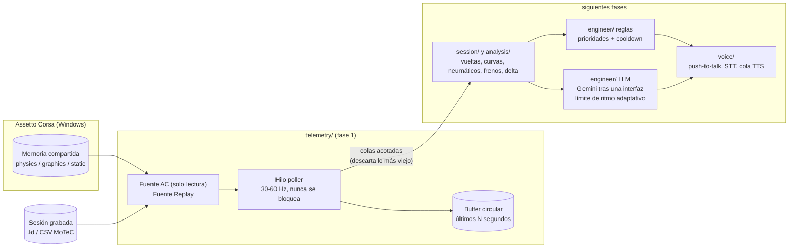

# pit-wall-ai

**Un ingeniero de pista con IA en tiempo real para Assetto Corsa.** Corre en segundo plano mientras juegas, lee la
telemetría en vivo del juego, te avisa de lo importante (neumáticos, frenos, combustible, ritmo, frenadas) y, en
fases posteriores, te responde cuando le hablas. Las alertas por reglas son locales e instantáneas; un modelo de
lenguaje (la API gratuita de Gemini, intercambiable) se usa solo para la conversación.

*English: [README.md](README.md)*

> **Estado: fase 1 de 7**: lector de telemetría en vivo, replay de sesiones grabadas y panel en terminal. Las
> alertas, el análisis de vueltas, el chat con Gemini y la voz llegan en las siguientes fases (ver
> [hoja de ruta](#hoja-de-ruta)).

<!-- DEMO: añade aquí un GIF o vídeo (panel de terminal ahora, demo de voz más adelante) -->
<p align="center"><em>Espacio para la demo: aquí irá un GIF del panel.</em></p>

## Arquitectura



El bucle de telemetría solo lee una fuente y añade al buffer. Todo lo lento (red, audio, análisis) vive en otros
hilos y recibe las muestras por colas acotadas: un consumidor lento pierde sus muestras más viejas en vez de
retrasar el bucle.

## Qué incluye la fase 1

* **`telemetry/`**: `Snapshot` tipado e inmutable; `ACSharedMemorySource` (Windows, `OpenFileMappingW` de solo
  lectura, reintento ante lecturas a medias, detección de cierre del juego); `ReplaySource` para logs `.ld` y CSV
  de MoTeC (reloj en tiempo real, multiplicador de velocidad, bucle, desfase inicial); `RingBuffer`; `TelemetryPoller`.
* **Panel** en terminal (`pit-wall run`) y **`pit-wall dump-shm`** para inspeccionar cada campo y confirmar unidades.
* **Configuración** en YAML + `.env`, validada (un error de tipeo en el YAML es un error), y **logging estructurado**
  (clave=valor o líneas JSON).
* **Base del LLM** lista para la fase 5: interfaz de proveedor con registro (ya hay un `mock` sin conexión), un
  **limitador de ritmo adaptativo** (aprende de los HTTP 429 / `Retry-After`, presupuesto diario opcional), caché
  corta y degradación elegante.

## Instalación

Requiere Windows para el juego en vivo (el replay funciona en cualquier sistema) y Python 3.11+.

```powershell
git clone https://github.com/ElSirGuti/pit-wall-ai.git
cd pit-wall-ai
python -m venv .venv
.venv\Scripts\activate
pip install -e ".[dev]"
copy .env.example .env     # solo hace falta desde la fase 5 (clave de Gemini)
```

## Uso

```powershell
# En vivo, con Assetto Corsa abierto
pit-wall run

# Sin el juego: reproduce uno de tus logs ACTI a 4x desde el segundo 100
pit-wall run --source replay --file C:\ruta\sesion.ld --speed 4 --start 100

# Una línea de estado por segundo (sin panel)
pit-wall run --plain

# Muestra todos los campos que publica el juego (y, con --watch, el rango de cada uno)
pit-wall dump-shm
pit-wall dump-shm --watch 60 --json report.json
```

`pit-wall --help` lista todas las opciones. Las comprobaciones: `pytest` y `ruff check src tests`.

## Configuración

Los valores por defecto están en [`config/default.yaml`](config/default.yaml) (son iguales a los incorporados).
Cópialo a `config/local.yaml` (ignorado por git) o apunta `PIT_WALL_CONFIG` a un archivo. Los secretos nunca van en
el YAML: pon `GEMINI_API_KEY` en `.env`, que está en `.gitignore` desde el primer commit. La sección `llm` ya elige
el proveedor y su ritmo adaptativo (`rate_limit`): las cuotas del plan gratuito cambian con el tiempo y solo se ven por
proyecto en Google AI Studio, así que el limitador aprende en vez de fiarse de un número fijo.

## Unidades de los campos del juego

El juego publica sus valores en sus propias unidades y **no hay una referencia oficial de Kunos para las páginas del
Assetto Corsa original** (el PDF que circula es de ACC, otro juego). Por eso las unidades se confirman contra el
propio juego, y esta tabla dice con honestidad en qué punto está cada una. Detalle y procedimiento:
[`docs/AC_SHARED_MEMORY.md`](docs/AC_SHARED_MEMORY.md).

Estado: **observado** = se leyó un valor real del juego en vivo · **pendiente** = hace falta un coche en pista ·
ninguna se marca como *verificada* hasta compararla con el HUD del juego.

| Campo | Unidad esperada (hipótesis) | Estado |
|---|---|---|
| `steer_angle` | grados *o* radianes, se desconoce | pendiente |
| `fuel` | litros | pendiente (`static.max_fuel` observado: 100,0) |
| `tyre_wear` | porcentaje *o* fracción; no se sabe qué extremo es "nuevo" | pendiente |
| `tyre_pressure` | psi | pendiente |
| `tyre_core_temp`, `tyre_temp_inner/middle/outer`, `brake_temp` | °C | pendiente |
| `gas`, `brake`, `clutch` | 0..1 | pendiente |
| `speed_kmh` | km/h | pendiente |
| `gear` | índice crudo (0 = marcha atrás, 1 = punto muerto es lo habitual) | pendiente |
| `normalized_pos` | 0..1 a lo largo de la vuelta | pendiente |
| `current/last/best_time_ms` | milisegundos | pendiente |
| `static.track_length_m` | metros | observado: 2367,68 (plausible) |
| `static.tyre_radius` | metros | observado: 0,326 (plausible) |
| `static.max_power` | vatios | observado: 237648 (plausible como W) |
| `static.max_torque` | N·m | observado: 115,0, **no se entiende** |
| orden de ruedas | FL, FR, RL, RR | pendiente |

La página `static` se leyó de un juego en marcha (AC 1.16.4, memoria compartida v1.7, en el menú) y se decodifica
correctamente de principio a fin. `physics` y `graphics` se confirman con `pit-wall dump-shm --watch 60` en pista.

## Hoja de ruta

| Fase | Contenido | Estado |
|---|---|---|
| 1 | Lector de telemetría, mock/replay, vista de consola, base del LLM | **esta versión** |
| 2 | Detector de sesión (práctica / clasificación / carrera), tracker de vueltas y sectores | prevista |
| 3 | Motor de alertas por reglas con TTS local | prevista |
| 4 | Análisis de frenadas por curva contra la mejor vuelta (geometría de pista generada en local) | prevista |
| 5 | Chat de texto con Gemini usando un resumen compacto de telemetría | prevista |
| 6 | Voz completa: push-to-talk (teclado y botón del Logitech G29), STT, respuestas habladas | prevista |
| 7 | Debrief post-sesión con Gemini | prevista |

## Procedencia y licencia

Nada de la instalación del juego se copia ni se distribuye, y no se incluye geometría de pistas (se genera en local en
una fase posterior): ver [PROVENANCE.md](PROVENANCE.md). Licencia MIT, ver [LICENSE](LICENSE). Sin afiliación con
Kunos Simulazioni.
