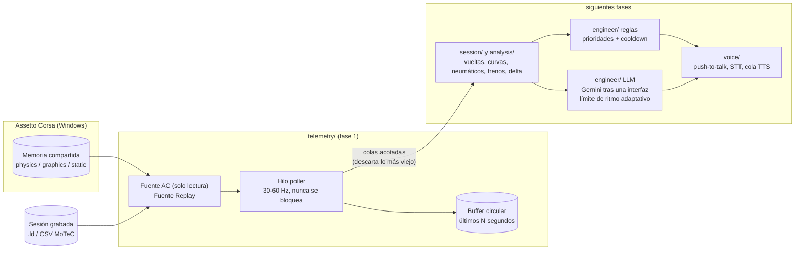

# pit-wall-ai

**Un ingeniero de pista con IA en tiempo real para Assetto Corsa.** Corre en segundo plano mientras juegas, lee la
telemetría en vivo del juego, te avisa de lo importante (neumáticos, frenos, combustible, ritmo, frenadas) y, en
fases posteriores, te responde cuando le hablas. Las alertas por reglas son locales e instantáneas; un modelo de
lenguaje (la API gratuita de Gemini, intercambiable) se usa solo para la conversación.

*English: [README.md](README.md)*

> **Estado: fase 1 de 7**: lector de telemetría en vivo, replay de sesiones grabadas y panel en terminal. Las
> alertas, el análisis de vueltas, el chat con Gemini y la voz llegan en las siguientes fases (ver
> [hoja de ruta](#hoja-de-ruta)).

<!-- DEMO: añade aquí un GIF o vídeo (panel de terminal ahora, demo de voz más adelante) -->
<p align="center"><em>Espacio para la demo: aquí irá un GIF del panel.</em></p>

## Arquitectura



El bucle de telemetría solo lee una fuente y añade al buffer. Todo lo lento (red, audio, análisis) vive en otros
hilos y recibe las muestras por colas acotadas: un consumidor lento pierde sus muestras más viejas en vez de
retrasar el bucle.

## Qué incluye la fase 1

* **`telemetry/`**: `Snapshot` tipado e inmutable; `ACSharedMemorySource` (Windows, `OpenFileMappingW` de solo
  lectura, reintento ante lecturas a medias, detección de cierre del juego); `ReplaySource` para logs `.ld` y CSV
  de MoTeC (reloj en tiempo real, multiplicador de velocidad, bucle, desfase inicial); `RingBuffer`; `TelemetryPoller`.
* **Panel** en terminal (`pit-wall run`) y **`pit-wall dump-shm`** para inspeccionar cada campo y confirmar unidades.
* **Configuración** en YAML + `.env`, validada (un error de tipeo en el YAML es un error), y **logging estructurado**
  (clave=valor o líneas JSON).
* **Base del LLM** lista para la fase 5: interfaz de proveedor con registro (ya hay un `mock` sin conexión), un
  **limitador de ritmo adaptativo** (aprende de los HTTP 429 / `Retry-After`, presupuesto diario opcional), caché
  corta y degradación elegante.

## Instalación

Requiere Windows para el juego en vivo (el replay funciona en cualquier sistema) y Python 3.11+.

```powershell
git clone https://github.com/ElSirGuti/pit-wall-ai.git
cd pit-wall-ai
python -m venv .venv
.venv\Scripts\activate
pip install -e ".[dev]"
copy .env.example .env     # solo hace falta desde la fase 5 (clave de Gemini)
```

## Uso

```powershell
# En vivo, con Assetto Corsa abierto
pit-wall run

# Sin el juego: reproduce uno de tus logs ACTI a 4x desde el segundo 100
pit-wall run --source replay --file C:\ruta\sesion.ld --speed 4 --start 100

# Una línea de estado por segundo (sin panel)
pit-wall run --plain

# Muestra todos los campos que publica el juego (y, con --watch, el rango de cada uno)
pit-wall dump-shm
pit-wall dump-shm --watch 60 --json report.json
```

`pit-wall --help` lista todas las opciones. Las comprobaciones: `pytest` y `ruff check src tests`.

## Configuración

Los valores por defecto están en [`config/default.yaml`](config/default.yaml) (son iguales a los incorporados).
Cópialo a `config/local.yaml` (ignorado por git) o apunta `PIT_WALL_CONFIG` a un archivo. Los secretos nunca van en
el YAML: pon `GEMINI_API_KEY` en `.env`, que está en `.gitignore` desde el primer commit. La sección `llm` ya elige
el proveedor y su ritmo adaptativo (`rate_limit`): las cuotas del plan gratuito cambian con el tiempo y solo se ven por
proyecto en Google AI Studio, así que el limitador aprende en vez de fiarse de un número fijo.

## Unidades de los campos del juego

El juego publica sus valores en sus propias unidades y **no hay una referencia oficial de Kunos para las páginas del Assetto Corsa original** (el PDF que circula es de ACC, otro juego). Por eso cada unidad se confirma contra el propio juego. Detalle y procedimiento: [`docs/AC_SHARED_MEMORY.md`](docs/AC_SHARED_MEMORY.md).

Estado: **verificada** = confirmada por una relación independiente dentro de una captura real (reloj, velocidad frente a velocidad de rueda y radio, distancia frente a velocidad media); **plausible** = el rango encaja con la unidad pero nada independiente la ha comprobado todavía (comparar con el HUD); **sin determinar** = aún no se entiende; **no fiable** = el juego no da un valor utilizable en este coche.

| Campo | Unidad | Estado | Evidencia |
|---|---|---|---|
| `speed_kmh` | km/h | verificada | igual a la norma de `local_velocity` × 3,6 con 7 cifras |
| `velocity, local_velocity` | m/s; en ejes del coche z = adelante, x = lateral, y = vertical | verificada | norma × 3,6 = `speed_kmh`; domina z |
| `wheel_angular_speed` | rad/s | verificada | ω × radio ≈ velocidad (delanteras −0,4 %…−1,9 %, trasera motriz +4,7 % con patinaje) |
| `static.tyre_radius` | metros | verificada | misma comprobación (0,34 m delante, 0,3525 m detrás) |
| `distance_traveled` | metros | verificada | 2256,9 m frente a velocidad media × 60 s = 2257,6 m |
| `current_time_ms, session_time_left` | milisegundos | verificada | Δ = 59 993 ms en una captura de 60 s (20 002 ms en 20 s) |
| `gas, brake` | 0..1 | verificada | observado 0,0 … 1,0 (freno a 1,0 en el pit) |
| `heading` | radianes, −π..π | verificada | observado −3,134 … 3,135 en una vuelta |
| `normalized_pos` | 0..1 a lo largo de la vuelta | verificada | 0,18 … 0,68, creciendo con `distance_traveled` |
| `acc_g` | g; x = lateral, y = vertical (sin gravedad), z = longitudinal | plausible | picos de ±2 g; frenada (−1,9) mayor que aceleración (+1,1) en z; faltan los signos con el HUD |
| `wheel_load` | newtons | plausible | total en pit 14,56 kN ≈ 1 484 kg·g para un GT4 con combustible y piloto |
| `fuel` | litros | plausible | 45,0 cargados, depósito 110,0; consumo 0,73 L/km (3,3 L por vuelta de 4,5 km) |
| `tyre_pressure` | psi | plausible | 25,7 … 28,9 (en bar serían ≈ 1,9) |
| `tyre_core_temp, tyre_temp_inner/middle/outer` | °C | plausible | 55 … 89 °C; 80 °C en el box |
| `tyre_wear` | porcentaje; 100 = nuevo | plausible | 100,0 con neumáticos nuevos y sin cambio en ~1,7 vueltas |
| `camber` | radianes | plausible | −0,056 rad = −3,2° delante izquierda, simétrico a la derecha |
| `suspension_travel` | metros | plausible | 0,011 … 0,080 |
| `brake_bias` | fracción delantera | plausible | 0,74 constante |
| `static.track_length_m` | metros | plausible | 4537,19 para el trazado GP de Hockenheim usado |
| `clutch` | parece el embrague engranado (1,0 = engranado), no el pedal | sin determinar | 0,0 en punto muerto (Supra en el pit, Alfa 4C al ralentí) y 1,0 con marcha puesta en todas las capturas; además el piloto tiene el eje del pedal invertido. No basar reglas en él |
| `gear` | índice crudo = número de marcha + 1: 1 = punto muerto, 2…7 = 1.ª…6.ª (marcha atrás presumiblemente 0, no vista) | verificada | HUD del piloto: crudo 7 = 6.ª, crudo 1 = punto muerto (también visto a 131 km/h durante un cambio) |
| `steer_angle` | fracción del giro del volante, −1..1 (tope = ±1,0; los grados necesitan el giro del coche) | verificada | prueba de tope a tope: mín −1,0000, máx +1,0000 exactos. Una vuelta completa (360°) de un volante de 900° dio −0,827 (×450° = 372°): lineal con los ±450° del volante. Una vuelta con horquilla llega a ≈ 0,5. El signo de la izquierda no está confirmado todavía |
| `tc`, `abs` | `tc` parece derivado del ajuste, `abs` una constante | sin determinar | `tc` 1,0 en el pit y 0,065 … 1,0 en la primera captura, 0,082 constante en la segunda con el TC en 4/8 (piloto); `abs` constante 0,12 |
| `wheel_slip` | definición desconocida | sin determinar | 0 … 977,7 con valores atípicos; no es una razón acotada |
| `wind_speed` | unidad desconocida | sin determinar | 2,0 constante (m/s o km/h) |
| `brake_temp` | °C en principio | no fiable | 26 en el pit, 15,0 constante en pista (= temperatura del aire) frenando a 244 km/h: no se simula en este coche; no basar reglas de frenos en ello |
| `static.max_power, max_torque` | — | no fiable | Supra GT4: 151 kW / 240 N·m; Audi TCR: 237,6 kW / 115 N·m: lejos de los coches reales |

Captura usada: Assetto Corsa 1.16.4, memoria compartida 1.7, servidor de práctica de LFM, Toyota Supra GT4 en Hockenheim (GP, sin DRS), 20 s en el box + 60 s en pista (1 199 + 3 600 muestras). Los dos informes están en `tests/fixtures/` y `tests/test_live_reports.py` vuelve a comprobar cada fila *verificada* en cada ejecución.

## Hoja de ruta

| Fase | Contenido | Estado |
|---|---|---|
| 1 | Lector de telemetría, mock/replay, vista de consola, base del LLM | **esta versión** |
| 2 | Detector de sesión (práctica / clasificación / carrera), tracker de vueltas y sectores | prevista |
| 3 | Motor de alertas por reglas con TTS local | prevista |
| 4 | Análisis de frenadas por curva contra la mejor vuelta (geometría de pista generada en local) | prevista |
| 5 | Chat de texto con Gemini usando un resumen compacto de telemetría | prevista |
| 6 | Voz completa: push-to-talk (teclado y botón del Logitech G29), STT, respuestas habladas | prevista |
| 7 | Debrief post-sesión con Gemini | prevista |

## Procedencia y licencia

Nada de la instalación del juego se copia ni se distribuye, y no se incluye geometría de pistas (se genera en local en
una fase posterior): ver [PROVENANCE.md](PROVENANCE.md). Licencia MIT, ver [LICENSE](LICENSE). Sin afiliación con
Kunos Simulazioni.
