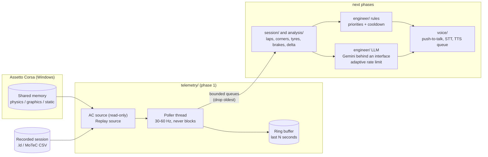

# pit-wall-ai

**A real-time AI race engineer for Assetto Corsa.** It runs in the background while you drive, reads the game's live
telemetry, warns you about what matters (tyres, brakes, fuel, pace, braking points) and, in later phases, answers
when you talk to it. Rule-based alerts are local and instant; a language model (Gemini's free API, swappable) is
only used for the conversation.

*Español: [README.es.md](README.es.md)*

> **Status: phase 4 of 7 (in progress)** — live telemetry, session and lap tracking, recording and replay, a
> rule-based race engineer with a local Windows voice (lock-ups, spins, fuel, tyres, lap summaries) and, new,
> per-corner braking analysis against your best lap, built from the racing line of **your own** game install
> (nothing from the game is shipped). Still to verify live: the spoken braking hint. The Gemini chat and full
> voice come next (see the [roadmap](#roadmap)).

<!-- DEMO: add a GIF or video here (terminal dashboard now, voice demo later) -->
<p align="center"><em>Demo placeholder: a GIF of the dashboard will go here.</em></p>

## Architecture



The telemetry loop only reads a source and appends to the buffer. Everything slow (network, audio, analysis)
lives in other threads and receives samples through bounded queues: a slow consumer loses its oldest samples
instead of delaying the loop.

## What phase 1 gives you

* **`telemetry/`**: typed immutable `Snapshot`; `ACSharedMemorySource` (Windows, read-only `OpenFileMappingW`,
  torn-read retry, game-exit detection); `ReplaySource` for `.ld` and MoTeC CSV logs (real-time clock, speed
  multiplier, loop, start offset); `RingBuffer`; `TelemetryPoller`.
* **Dashboard** in the terminal (`pit-wall run`) and **`pit-wall dump-shm`** to inspect every field and confirm units.
* **Config** in YAML + `.env`, validated (a typo in the YAML is an error), and **structured logging** (key=value or JSON lines).
* **LLM foundations** ready for phase 5: provider interface with a registry (an offline `mock` ships now), an
  **adaptive rate limiter** (learns from HTTP 429 / `Retry-After`, optional daily budget), a short cache and graceful degradation.

## Install

Requires Windows for the live game (replay works anywhere) and Python 3.11+.

```powershell
git clone https://github.com/ElSirGuti/pit-wall-ai.git
cd pit-wall-ai
python -m venv .venv
.venv\Scripts\activate
pip install -e ".[dev]"
copy .env.example .env     # only needed from phase 5 (Gemini key)
```

## Use

```powershell
# Live, with Assetto Corsa running
pit-wall run

# Without the game: replay one of your own ACTI logs at 4x speed from second 100
pit-wall run --source replay --file C:\path\to\session.ld --speed 4 --start 100

# One status line per second (no dashboard)
pit-wall run --plain

# Record a real session (the game's own fields) and replay it later
pit-wall record --out race.pwrec.gz
pit-wall run --file race.pwrec.gz --speed 4

# Phase 4: numbered corners of a track from the game's racing line, and every lap against your best lap
pit-wall corners --file race.pwrec.gz
pit-wall corners --file race.pwrec.gz --laps
pit-wall corners --track spa --length 6947

# Show every field the game publishes (and, with --watch, the range of each one)
pit-wall dump-shm
pit-wall dump-shm --watch 60 --json report.json

# The engineer: speak the alerts (Windows voice; pip install -e ".[voice]")
pit-wall run --voice                 # Spanish, Sabina if installed
pit-wall run --voice --language en
pit-wall run --mute                  # same rules, printed instead of spoken
pit-wall say "Box this lap"          # test the voice and see its latency
pit-wall rules                       # active rules, thresholds and per-session policies
```

See [docs/ENGINEER.md](docs/ENGINEER.md) for how a message is decided, the rules and the measured latency, and
[docs/TRACK_GEOMETRY.md](docs/TRACK_GEOMETRY.md) for the corner geometry, the braking comparison, the spoken hint
and how the alignment with the game's lap position was verified (error below 0.5 m on Magione, Imola, Spa).

```bash
# Phase 5: the text chat (local answers always; the cloud model only if you turn it on, see docs/LLM.md)
pit-wall ask "how much fuel is left?" --file race.pwrec.gz
pit-wall chat                       # live game; type exit to finish
pit-wall llm-check --allow-cloud    # test the cloud model
```

One chat, any service: the plan for other providers and the final `.exe` is in
[docs/PROVIDERS_PLAN.md](docs/PROVIDERS_PLAN.md).

`pit-wall --help` lists every option. Run the checks with `pytest` and `ruff check src tests`.

## Configuration

Defaults live in [`config/default.yaml`](config/default.yaml) (they equal the built-in ones). Copy it to
`config/local.yaml` (git-ignored) or point `PIT_WALL_CONFIG` at a file. Secrets never go in YAML: put
`GEMINI_API_KEY` in `.env`, which is git-ignored from the first commit. The LLM section already selects the
provider and its adaptive pacing (`rate_limit`): the free tier's quotas change over time and are only shown
per project in Google AI Studio, so the limiter learns instead of trusting a fixed number.

## Units of the game's fields

The game publishes its values in its own units and there is **no official Kunos reference for the original Assetto Corsa pages** (the PDF that circulates is for ACC, a different game). So every unit is confirmed against the game itself. Detail and the procedure: [`docs/AC_SHARED_MEMORY.md`](docs/AC_SHARED_MEMORY.md).

Status: **verified** = confirmed by an independent relationship inside a real capture (wall clock, speed vs wheel speed and tyre radius, distance vs mean speed); **plausible** = the range fits the unit but nothing independent has checked it yet (compare with the HUD); **undetermined** = not understood yet; **unreliable** = the game does not provide a usable value for this car.

| Field | Unit | Status | Evidence |
|---|---|---|---|
| `speed_kmh` | km/h | verified | equals the norm of `local_velocity` × 3.6 to 7 digits |
| `velocity, local_velocity` | m/s; in the car frame z = forward, x = lateral, y = vertical | verified | norm × 3.6 = `speed_kmh`; z dominates |
| `wheel_angular_speed` | rad/s | verified | ω × tyre radius ≈ speed (front −0.4 %…−1.9 %, driven rear +4.7 % under wheelspin) |
| `static.tyre_radius` | metres | verified | same check (0.34 m front, 0.3525 m rear) |
| `distance_traveled` | metres | verified | 2256.9 m vs mean speed × 60 s = 2257.6 m |
| `current_time_ms, session_time_left` | milliseconds | verified | Δ = 59 993 ms over a 60 s capture (20 002 ms over 20 s) |
| `gas, brake` | 0..1 | verified | observed 0.0 … 1.0 (brake held at 1.0 in the pit) |
| `heading` | radians, −π..π | verified | observed −3.134 … 3.135 over one lap |
| `normalized_pos` | 0..1 around the lap | verified | 0.18 … 0.68, rising with `distance_traveled` |
| `acc_g` | g; x = lateral, y = vertical (gravity excluded), z = longitudinal | plausible | peaks ±2 g; braking (−1.9) stronger than acceleration (+1.1) on z; HUD pending for signs |
| `wheel_load` | newtons | plausible | pit total 14.56 kN ≈ 1 484 kg·g for a GT4 with fuel and driver |
| `fuel` | litres | plausible | 45.0 loaded, tank 110.0; burn 0.73 L/km (3.3 L per 4.5 km lap) |
| `tyre_pressure` | psi | plausible | 25.7 … 28.9 (a bar value would be ≈ 1.9) |
| `tyre_core_temp, tyre_temp_inner/middle/outer` | °C | plausible | 55 … 89 °C; 80 °C at the pit box |
| `tyre_wear` | percent; 100 = new | plausible | 100.0 on new tyres and unchanged for ~1.7 laps |
| `camber` | radians | plausible | −0.056 rad = −3.2° front left, mirrored on the right |
| `suspension_travel` | metres | plausible | 0.011 … 0.080 |
| `brake_bias` | fraction front | plausible | 0.74 constant |
| `static.track_length_m` | metres | plausible | 4537.19 for the Hockenheim GP layout used |
| `clutch` | looks like the clutch engagement (1.0 = engaged), not the pedal | undetermined | 0.0 in neutral (Supra in the pit, Alfa 4C at idle) and 1.0 in gear in every capture; the driver's controls also have the pedal axis inverted. Do not build rules on it |
| `gear` | raw index = gear number + 1: 1 = neutral, 2…7 = 1st…6th (reverse presumably 0, not seen) | verified | driver's HUD: raw 7 = 6th gear, raw 1 = neutral (also seen at 131 km/h mid-shift) |
| `steer_angle` | fraction of the steering lock, −1..1 (full lock = ±1.0; degrees need the car's lock) | verified | lock-to-lock test: min −1.0000, max +1.0000 exactly. One full turn (360°) of a 900° wheel read −0.827 (×450° = 372°): linear with the wheel's ±450°. A hairpin lap peaks at ≈ 0.5. Turning left reads negative (driver turned left: −0.827), right is positive |
| `tc`, `abs` | `tc` looks like a setting-derived value, `abs` a constant | undetermined | `tc` 1.0 in the pit and 0.065 … 1.0 in the first capture, constant 0.082 in the second with TC set to 4/8 (driver); `abs` constant 0.12 |
| `wheel_slip` | definition unknown | undetermined | 0 … 977.7 with outliers; not a bounded ratio |
| `wind_speed` | unit unknown | undetermined | 2.0 constant (m/s or km/h) |
| `brake_temp` | °C in principle | unreliable | 26 in the pit, 15.0 constant on track (= air temperature) while braking at 244 km/h: not simulated for this car; do not build brake rules on it |
| `static.max_power, max_torque` | — | unreliable | MX-5 Cup 108.7 kW / 187 N·m is plausible, Supra GT4 and Audi TCR are not: it depends on the car |

Capture used: Assetto Corsa 1.16.4, shared-memory 1.7, LFM practice server, Toyota Supra GT4 at Hockenheim (GP, no DRS), 20 s in the pit box + 60 s on track (1 199 + 3 600 samples). The two reports are in `tests/fixtures/` and `tests/test_live_reports.py` re-checks every *verified* row on each run.

## Roadmap

| Phase | Content | Status |
|---|---|---|
| 1 | Telemetry reader, mock/replay, console view, LLM foundations | done |
| 2 | Session detector (practice / qualify / race), lap and sector tracker, `pit-wall record` | done, checked on a real qualifying + race ([docs](docs/SESSION_AND_LAPS.md)) |
| 3 | Rule-based alert engine with local TTS | done ([docs](docs/ENGINEER.md)); thresholds conservative, to calibrate |
| 4 | Braking analysis per corner vs the best lap (track geometry generated locally) | **in progress** ([docs](docs/TRACK_GEOMETRY.md)): geometry, numbering, per-corner comparison and the spoken hint are in; to be checked live and against the real circuits' numbering |
| 5 | Text chat with Gemini using a compact telemetry summary, plan in [docs/PHASE5_PLAN.md](docs/PHASE5_PLAN.md) (including questions such as "which corner is that?", answered from the geometry) | planned |
| 6 | Full voice (buttons done; microphone and voice/output selection coded: `pit-wall devices`, `mic-test`, `voices --test`): push-to-talk bindable to any button of any device (keyboard, mouse, gamepad, wheel, button box; [plan](docs/INPUT_BINDINGS.md)), STT, spoken answers | planned ([plan](docs/PHASE6_PLAN.md)) |
| 6b | The engineer as a character: radio protocol (half-duplex, ACK, acknowledgement phrase), profiles and personas, names, conversation memory | planned, see [docs/ENGINEER_EXPERIENCE_PLAN.md](docs/ENGINEER_EXPERIENCE_PLAN.md) |
| 7 | Post-session debrief with Gemini | planned |
| 8 | Race preparation: strategy plan with an editable practice checklist, rivals brief, setup and driving-style suggestions | planned, see [docs/PHASE8_PLAN.md](docs/PHASE8_PLAN.md) |
| 9 | More simulators (ACC, iRacing, rFactor 2 / Le Mans Ultimate, Automobilista 2, RaceRoom, AC Evo) with automatic detection | planned, see [docs/MULTI_SIM_PLAN.md](docs/MULTI_SIM_PLAN.md); only the original AC is supported today |
| 10 | Race events: flags, damage, safety car, overtakes and gaps | planned (needs real captures and the rivals feed), same plan |
| 11 | Settings interface (local web page) and profiles per simulator | planned, same plan |

## Open items for the author

What a person has to do (record a second session, rotate the key, voice samples) is in
[docs/PENDIENTES.md](docs/PENDIENTES.md) (Spanish).

## Provenance and licence

Nothing from the game's install is copied or shipped, and no track geometry is included (it is generated locally
in a later phase): see [PROVENANCE.md](PROVENANCE.md). MIT licence, see [LICENSE](LICENSE). Not affiliated with
Kunos Simulazioni.
