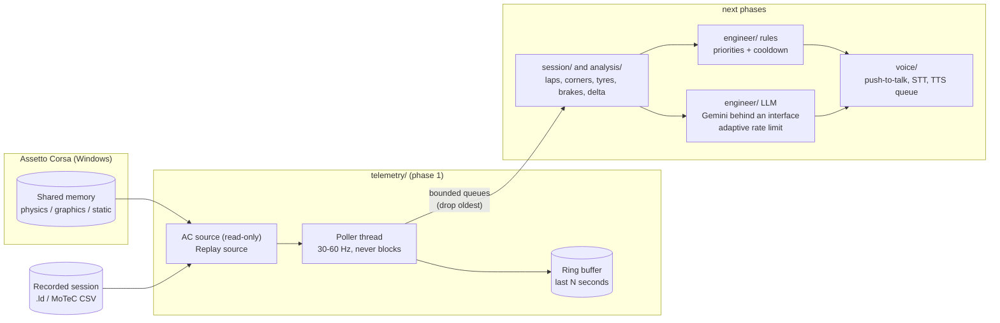

# pit-wall-ai

**A real-time AI race engineer for Assetto Corsa.** It runs in the background while you drive, reads the game's live
telemetry, warns you about what matters (tyres, brakes, fuel, pace, braking points) and, in later phases, answers
when you talk to it. Rule-based alerts are local and instant; a language model (Gemini's free API, swappable) is
only used for the conversation.

*Español: [README.es.md](README.es.md)*

> **Status: phase 1 of 7** — live telemetry reader, replay of recorded sessions, terminal dashboard. Alerts,
> lap analysis, the Gemini chat and voice come in the next phases (see the [roadmap](#roadmap)).

<!-- DEMO: add a GIF or video here (terminal dashboard now, voice demo later) -->
<p align="center"><em>Demo placeholder: a GIF of the dashboard will go here.</em></p>

## Architecture



The telemetry loop only reads a source and appends to the buffer. Everything slow (network, audio, analysis)
lives in other threads and receives samples through bounded queues: a slow consumer loses its oldest samples
instead of delaying the loop.

## What phase 1 gives you

* **`telemetry/`**: typed immutable `Snapshot`; `ACSharedMemorySource` (Windows, read-only `OpenFileMappingW`,
  torn-read retry, game-exit detection); `ReplaySource` for `.ld` and MoTeC CSV logs (real-time clock, speed
  multiplier, loop, start offset); `RingBuffer`; `TelemetryPoller`.
* **Dashboard** in the terminal (`pit-wall run`) and **`pit-wall dump-shm`** to inspect every field and confirm units.
* **Config** in YAML + `.env`, validated (a typo in the YAML is an error), and **structured logging** (key=value or JSON lines).
* **LLM foundations** ready for phase 5: provider interface with a registry (an offline `mock` ships now), an
  **adaptive rate limiter** (learns from HTTP 429 / `Retry-After`, optional daily budget), a short cache and graceful degradation.

## Install

Requires Windows for the live game (replay works anywhere) and Python 3.11+.

```powershell
git clone https://github.com/ElSirGuti/pit-wall-ai.git
cd pit-wall-ai
python -m venv .venv
.venv\Scripts\activate
pip install -e ".[dev]"
copy .env.example .env     # only needed from phase 5 (Gemini key)
```

## Use

```powershell
# Live, with Assetto Corsa running
pit-wall run

# Without the game: replay one of your own ACTI logs at 4x speed from second 100
pit-wall run --source replay --file C:\path\to\session.ld --speed 4 --start 100

# One status line per second (no dashboard)
pit-wall run --plain

# Show every field the game publishes (and, with --watch, the range of each one)
pit-wall dump-shm
pit-wall dump-shm --watch 60 --json report.json
```

`pit-wall --help` lists every option. Run the checks with `pytest` and `ruff check src tests`.

## Configuration

Defaults live in [`config/default.yaml`](config/default.yaml) (they equal the built-in ones). Copy it to
`config/local.yaml` (git-ignored) or point `PIT_WALL_CONFIG` at a file. Secrets never go in YAML: put
`GEMINI_API_KEY` in `.env`, which is git-ignored from the first commit. The LLM section already selects the
provider and its adaptive pacing (`rate_limit`): the free tier's quotas change over time and are only shown
per project in Google AI Studio, so the limiter learns instead of trusting a fixed number.

## Units of the game's fields

The game publishes its values in its own units and there is **no official Kunos reference for the original
Assetto Corsa pages** (the PDF that circulates is for ACC, a different game). So units are confirmed against the
game itself, and this table says honestly where each one stands. Full detail and the procedure:
[`docs/AC_SHARED_MEMORY.md`](docs/AC_SHARED_MEMORY.md).

Status: **observed** = a real value was read from the live game · **pending** = needs a car on track ·
nothing is marked *verified* until it has been compared with the in-game HUD.

| Field | Expected unit (hypothesis) | Status |
|---|---|---|
| `steer_angle` | degrees *or* radians, unknown | pending |
| `fuel` | litres | pending (`static.max_fuel` observed: 100.0) |
| `tyre_wear` | percent *or* fraction; which end means "new" is unknown | pending |
| `tyre_pressure` | psi | pending |
| `tyre_core_temp`, `tyre_temp_inner/middle/outer`, `brake_temp` | °C | pending |
| `gas`, `brake`, `clutch` | 0..1 | pending |
| `speed_kmh` | km/h | pending |
| `gear` | raw index (0 = reverse, 1 = neutral is common) | pending |
| `normalized_pos` | 0..1 around the lap | pending |
| `current/last/best_time_ms` | milliseconds | pending |
| `static.track_length_m` | metres | observed: 2367.68 (plausible) |
| `static.tyre_radius` | metres | observed: 0.326 (plausible) |
| `static.max_power` | watts | observed: 237648 (plausible as W) |
| `static.max_torque` | N·m | observed: 115.0, **not understood** |
| per-wheel order | FL, FR, RL, RR | pending |

The `static` page was read from a running game (AC 1.16.4, shared-memory version 1.7, in the menu) and decodes
correctly end to end. `physics` and `graphics` are confirmed with `pit-wall dump-shm --watch 60` on track.

## Roadmap

| Phase | Content | Status |
|---|---|---|
| 1 | Telemetry reader, mock/replay, console view, LLM foundations | **this release** |
| 2 | Session detector (practice / qualify / race), lap and sector tracker | planned |
| 3 | Rule-based alert engine with local TTS | planned |
| 4 | Braking analysis per corner vs the best lap (track geometry generated locally) | planned |
| 5 | Text chat with Gemini using a compact telemetry summary | planned |
| 6 | Full voice: push-to-talk (keyboard and Logitech G29 button), STT, spoken answers | planned |
| 7 | Post-session debrief with Gemini | planned |

## Provenance and licence

Nothing from the game's install is copied or shipped, and no track geometry is included (it is generated locally
in a later phase): see [PROVENANCE.md](PROVENANCE.md). MIT licence, see [LICENSE](LICENSE). Not affiliated with
Kunos Simulazioni.
